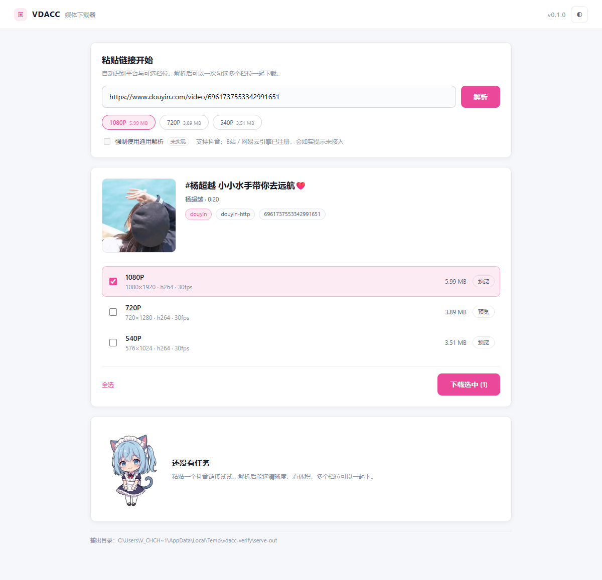

# DYDownload —— 抖音视频下载器

把抖音上看到的视频存到本地，1080p 原画质、无水印。粘贴分享口令就行。

## 怎么用

**双击 `抖音下载器.bat`**，弹出窗口后：

1. 把抖音里「复制链接」得到的**整段文字**直接粘进去（不用挑链接，脚本自己抠）
2. 多个视频就一行一个
3. 点「开始下载」

文件存到 `下载\`，命名格式 `视频ID_标题.mp4`。同一个视频重复下载会自动跳过。

下载有两条路：**默认先走纯 HTTP 签名引擎**（自己算 `x-secsdk-web-signature`，实测 1.2 秒一条，
不需要浏览器、不需要 cookie），失败才回退 Playwright 截流。用 `--engine` 可以强制指定。

## 为什么不用 yt-dlp / 那些 GUI

> **2026-10-21 更正**：这里原先写"抖音详情接口要求 `a_bogus` 签名，只有浏览器 JS 算得出"——**这条是错的**。
> 真正的门是 `x-secsdk-web-signature`，算法为 `md5(f"{uifid}_{timestamp}_{SALT}_{query}")`，salt 硬编码，
> 纯 HTTP 可算，不需要浏览器也不需要 cookie（实测记录见 `Plan.md` 的变更日志）。
> yt-dlp 的修复在 [PR #17826](https://github.com/yt-dlp/yt-dlp/pull/17826)，尚未合并；
> 合并前官方版仍报 `Fresh cookies needed`——这是误导性报错，不是真的缺 cookie。

那为什么还留着浏览器方案？理由已经和"签名"无关了：

1. **上游修复未落地时的兜底**：不用等 yt-dlp 发版，页面能播就能下。
2. **它天然覆盖其它需要真实浏览器的场景**：登录墙、m3u8/DASH 嗅探，以及后续的小红书/快手这类站点。

更不能靠"读浏览器 cookie"这条路，实测有三道墙：

| 墙 | 现象 |
|---|---|
| 文件锁 | Edge 运行时会独占 `Network\Cookies`，连只读都 PermissionError |
| 后台复活 | 关掉 Edge 后几秒它自己又拉起来（"关闭后继续运行后台扩展"） |
| App-Bound Encryption | 就算抢到文件 + Local State，Chromium 127+ 的密钥绑死在浏览器进程，报 `Failed to decrypt with DPAPI` |

**所以本工具换了个思路：不自己发请求，让浏览器去发，我在旁边截响应。**

```
Playwright 起一个独立 Edge（独立 profile，不碰你正在用的）
  → 打开视频页，浏览器自己算签名、自己请求 detail
  → 截下 detail JSON（含 24~30 档清晰度）和视频 CDN 地址
  → 按码率排序，逐个试下，实际比字节数取最大的
  → 用浏览器上下文下载（自动带 cookie + Referer）
```

## Web 界面

`python -m vdl serve` 启动后，用打印出的带 token 地址打开：

- 解析后显示封面 / 标题 / 作者 / 时长，画质 chips 带真实体积；
- 支持**多选档位同时下载**（文件名带清晰度后缀，不会互相覆盖）；
- 每个档位可「预览」（同源接口现取直链，不落盘）；
- 任务进度走 SSE 实时更新，完成后可直接定位到文件。



## 手机 / 局域网 / infOS

```bash
vdl serve --lan                     # 额外打印局域网地址（带 token）
vdl serve --allow-origin http://localhost:5173   # 允许 infOS 开发源调用
```

- 手机和电脑在同一网段时，用打印出的局域网地址直接打开即可（同一套界面，已自适应窄屏）。
- 任务卡完成后多一个「下载」按钮，走 `/api/files/<jobId>` 把文件取回手机。
- 公共 WiFi 下别开 `--lan`：拿到链接的任意设备都能提交任务。
- infOS 的接入方式见 [`integrations/infos/README.md`](integrations/infos/README.md)（薄页面，不改宿主代码）。

## 做成 Skill（给其它 Agent 用）

```bash
python tools/build_skill.py --zip     # 产物 dist/video-acquire.zip（约 42 KB）
```

安装：解压到 Agent 的 skills 目录（例如 `~/.codebuddy/skills/video-acquire/`）。
Skill 只带 CLI，不含 Web 界面；入口是 `scripts/vdl_run.py`，用法与错误码见包内 `SKILL.md`。

```bash
python scripts/vdl_run.py doctor --json
python scripts/vdl_run.py probe "<url>" --json
python scripts/vdl_run.py get "<url>" --json -o 下载
```

仓库是唯一事实来源：改代码只改仓库，重新 build 即可；`dist/` 不入库。

## 目录说明

```
DYDownload\
├─ 抖音下载器.bat     双击启动图形界面
├─ dy_gui.pyw         界面代码（tkinter）
├─ dy_dl.py           入口 + 浏览器引擎（Playwright 截流），也能命令行直接用
├─ dy_http.py         纯 HTTP 引擎（只用标准库，自己算签名；无浏览器也能跑）
├─ venv\              独立 Python 环境（playwright + yt-dlp）
├─ browser_profile\   独立浏览器配置（58MB，删了会自动重建）
└─ 下载\              输出目录
```

## 命令行用法

```bash
venv\Scripts\python.exe dy_dl.py "https://v.douyin.com/xxxx/"
venv\Scripts\python.exe dy_dl.py 7601899463951770978
venv\Scripts\python.exe dy_dl.py "链接1" "链接2" --force
venv\Scripts\python.exe dy_dl.py 链接 --headful    # 显示浏览器窗口，排错用
venv\Scripts\python.exe dy_dl.py 链接 --engine http      # 只用纯 HTTP（不需要 playwright）
venv\Scripts\python.exe dy_dl.py 链接 --engine browser   # 只用浏览器截流
```

`--force` 强制重下（默认跳过已存在的）。

`--engine` 三档：`auto`（默认，HTTP 优先、失败回退）/ `http` / `browser`。
纯 HTTP 引擎只依赖标准库，所以系统 Python 也能直接跑：`python dy_http.py "链接" -o 目录`。

## 新命令行（vdl，给 agent / GUI 用）

`vdl` 是统一 core：抖音走纯 HTTP 引擎，输出稳定 JSON，B站/网易云已注册但会如实返回 `not_implemented`。

```bash
python -m vdl probe "链接" --json              # 只解析：标题/作者/档位/真实体积
python -m vdl get "链接" --json -o 下载         # 下载（默认推荐档）
python -m vdl get "链接" --format normal_720_0 -o 下载
python -m vdl doctor --json                    # 环境体检：ffmpeg / playwright / yt-dlp / 登录态
python -m vdl auth bilibili                    # 弹独立浏览器扫码，导出 cookie
python -m vdl auth netease
python -m vdl auth --status                    # 只看登录状态
python -m vdl serve                            # 打开本地 Web 界面（默认 8765）
```

`--json` 时 **stdout 只有 JSON**，日志走 stderr；文件名形如 `视频ID_标题_1080P.mp4`，
不同档位同时下载不会互相覆盖。

日常使用还有四条：

```bash
vdl config                                  # 查看配置
vdl config --set outDir=D:\下载              # 改输出目录
vdl doctor --fix                            # 自动补装 pip 依赖（ffmpeg 需手动）
```

- **任务历史会保存**：服务端保留最近 100 条，重启后仍在；上次没跑完的标为「上次会话中断」。
- **断点续传**：失败或被取消时保留 `.part`，重跑自动从断点继续；网络/5xx 类错误自动重试 3 次。
- **任务可取消/重试**：任务卡上有「取消」「重试」；取消不会删半截文件。
- **`doctor --live`**：对抖音/网易云/B站各真解析一次；`--bundle` 生成脱敏诊断包（不含 cookie）。
- **并发**：`vdl serve --concurrency 2`（默认 1，对平台更友好）。
- **Windows 一键启动**：双击 `VDACC.bat`（首次会建 venv 并装依赖）。

音乐用同一个入口（`vdl probe` / `vdl get` 支持 `music.163.com/song?id=...`）：

```bash
python -m vdl probe "https://music.163.com/song?id=28606052"
python -m vdl get   "https://music.163.com/song?id=28606052"          # 默认无损
python -m vdl get   "https://music.163.com/song?id=28606052" --format exhigh  # 320K
```

登录后（`vdl auth netease`）默认取 **无损 FLAC**，未登录最高 320K 并给出提示。
落盘时用 ffmpeg 写标题/歌手/专辑/年份 + 800px 封面，歌词另存 `.lrc`。

B站（不登录通常只到 720P，1080P+ 需要 `vdl auth bilibili`）：

```bash
python -m vdl auth bilibili
python -m vdl probe "https://www.bilibili.com/video/BV1j5nj68E48"
python -m vdl get   "https://www.bilibili.com/video/BV1j5nj68E48" --format bili-1920
```

清晰度按**宽度**归档（4K / 2K / 1080P / 720P / 480P），同档位优先 H.264 保证兼容；
下载时自动配对最佳音轨并用 ffmpeg 合并成一个 mp4。

**其它站点**会自动交给 yt-dlp 兜底（引擎名 `ytdlp-generic`）：抖音/B站/网易云之外的
http(s) 链接会被尝试一次，失败时返回 yt-dlp 的原始报错，而不是一句「不支持」。

`vdl serve` 会打印一个带 `token` 的地址，**必须用那个地址打开**（直接访问 127.0.0.1:8765
会拿不到 token，接口返回 401）。token 只在本机有效，用来防别的网页偷偷向本地服务发任务。

## 常见问题

**换了新视频下不动了？**
先看日志里是哪一层失败：
- 出现 `[HTTP 失败] ... → 回退浏览器` 且浏览器成功 → 只是签名参数变了，浏览器兜底生效；
  这时该修的是 `dy_http.py`（`SALT` 或 query 参数），不是浏览器那套
- 两层都失败 → 跑 `--headful` 看浏览器里能不能正常播放：
  - 能播放但脚本报错 → 接口字段变了，检查 `collect_candidates()` / `_candidates()` 里的 `bit_rate`、`play_addr` 路径
  - 浏览器里也播不了 → 视频本身被限（私密/已删/地区限制）

**文件只有几百 KB 正常吗？**
正常。抖音竖屏短视频码率本身就低（这条 9 秒 1080×1440 只有 731kbps / 0.8MB）。脚本已经取了最高档，不是压缩过。

**能下别的平台吗？**
这个工作空间专治抖音。B 站、YouTube、小红书等可以直接用 venv 里的 yt-dlp（除抖音外都是好的；抖音的修复还没合并，见上文）：

```bash
venv\Scripts\python.exe -m yt_dlp -F "视频链接"
venv\Scripts\python.exe -m yt_dlp "视频链接"
```

**下载的文件没有水印吗？**
没有。取的是抖音自己发布的播放流，不是后期裁剪去水印。

## 许可证

代码以 **Apache-2.0** 发布，见 [`LICENSE`](LICENSE)。

角色美术（`vdl/web/assets/`）与第三方组件不在 Apache-2.0 范围内，见 [`NOTICE`](NOTICE)
与 [`THIRD_PARTY.md`](THIRD_PARTY.md)。路线图见 [`docs/ROADMAP.md`](docs/ROADMAP.md)。
