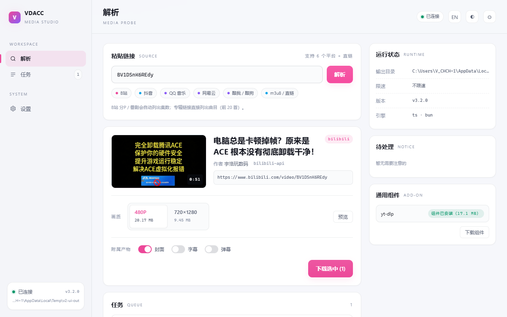

# VDACC —— 多平台视频 / 音频下载器

> **3.0 起后端主线为 TypeScript（Bun）**：抖音 / B站（含分P、番剧）/ 网易云的解析与本地服务
> 已迁移，Python 版本已归档到 `legacy/python/`（`vdl/`、`skill/`、`tests/`、`tools/`），
> 冻结为参考实现。需要 **Bun 1.2+**。
>
> ```bash
> bun ts/src/server.ts --port 8765 --token <token>   # Web 界面（仓库根 web/，Vue）
> bun ts/src/server.ts --port 8765 --token <token> --lan   # 局域网模式：手机壳可访问
> bun ts/src/cli.ts probe "<url>" --json
> bun ts/src/cli.ts get "<url>" -o 下载
> bun ts/src/cli.ts get "<url>" -o 下载 --limit 2M  # 可选限速（K/M 后缀）
> bun ts/src/cli.ts get "<url>" --cover             # 抖音 / B站独立封面图片
> bun ts/src/cli.ts get "<url>" --subs              # 顺带落同名 .srt（中文/AI 中文字幕优先）
> bun ts/src/cli.ts get "<url>" --danmaku           # 落同名 .danmaku.xml（B站 弹幕）
> bun ts/src/cli.ts get "<album-url>" --album --dry-run   # 专辑曲目预览（上限 20）
> bun ts/src/cli.ts get "<album-url>" --album             # 逐首下载（失败继续并汇总）
> bun ts/src/cli.ts get "<m3u8 或直链 mp4>"               # L2：HLS 用 ffmpeg 合成 mp4
> bun ts/src/cli.ts doctor                            # 只读诊断：ffmpeg / 组件 / 目录 / 凭据
> bun ts/src/cli.ts auth <bilibili|netease|qq> --status   # 默认在线校验 cookie 是否还有效
> bun ts/src/cli.ts auth <bilibili|netease|qq>            # 失效就重扫（弹独立 Edge）
> ```
>
> 迁移状态：引擎 ✅（抖音 / 网易云 / QQ 音乐 / 酷我 / 酷狗 / B站 分P·番剧 / L2 直链·m3u8）、
> 服务 ✅（probe / jobs / SSE / files / settings / cancel / retry / 持久化）、`auth` ✅（在线校验）、
> **Skill ✅**、**TS 测试 100 个 ✅**、**yt-dlp 可选组件 ✅（SHA256 校验）**、**设置面板 ✅**、**限速 ✅**（`--limit 2M`）、**并发 1–4 ✅**、
> **B站字幕 `--subs` / 弹幕 `--danmaku` ✅**（CLI 与 Web UI 都能开）、
> **专辑 `--album` ✅**（CLI `--offset` + `--dry-run`；Web UI 分批加载，每批 20 首）、
> **QQ 音乐 ✅**（`auth qq` 扫码；档位由账号会员权限决定）。
>
> 首次运行 `auth` 前需要装依赖：`cd ts && bun install`（只装 `playwright-core`，复用系统 Edge）。
>
> TS 版 Skill：`python tools/build_skill_ts.py --zip` → `dist/video-acquire-ts.zip`
> （实测 zip 42.6MB，内含 91.9MB 的 `vdl.exe`，不需要 Python/Node；包内有 `manifest.json` 与 `SHA256SUMS`）。
>
> 前端：`/` 是 **Vue 3** 界面，已按 **infOS 风格 V2** 重做（侧栏 + 双栏、浅槽画质、开关、Slide-over 设置）；
> 解析/多选/分P批量/专辑/下载/SSE/主题/中英切换/下载前预览都在。旧版原生界面已删除，Vue 是唯一入口。

## 当前修复与验收（3.3.1，2026-10-26）

本轮修复同源与文件访问边界、设置/历史假保存、Skill 未支持平台误路由、
解析与下载串状态、封面开关和断线恢复。源码版本为 3.3.1；标签与 Release 分发另行安排。
后续开发见 [Plan.md §2.6](Plan.md) 与 [交互详情图](docs/design/development-roadmap-2026-10-25.html)。

```bash
bun test ts/tests                          # 75 项离线回归
node tools/accept_regression_ui.cjs         # Edge + 临时用户目录 + 本地媒体
python tools/build_skill_ts.py --zip        # Skill 编译与组装（含 manifest.json / SHA256SUMS）
python tools/verify_skill_ts.py dist/video-acquire-ts   # 解压后核对每个文件的 SHA256
```

界面回归依赖 `cd ts && bun install` 和系统 Edge；不读取真实用户配置或凭据。
可用 `node tools/accept_regression_ui.cjs --python-acceptance` 同时验证 Python 验收入口
（默认使用仓库 venv，可通过 `VDL_TEST_PYTHON` 指定已装 Playwright 的 Python）。
本轮未重新验收第三方站点在线下载、会员档位或 Android 真机。

## Python legacy（仍可用，不再演进）

支持抖音（纯 HTTP 签名，浏览器兜底）、B站（含 4K，需登录）、网易云音乐（无损），
其它 http(s) 站点交给 yt-dlp 兜底。三种用法：**Web 界面**（`vdl serve`）、**命令行**（`vdl`）、
**Agent Skill**（`video-acquire`）。

下面这个 tkinter 界面是抖音专用的轻量入口；要下 B站/音乐或同时选多个档位，用 Web 界面。

## 怎么用

**双击 `VDACC.bat`**：启动本地服务（默认 8765）并自动用浏览器打开带 token 的地址。

1. 粘贴抖音 / B站 / 网易云链接（B站 分P 会列出集数，默认 1080P）
2. 选画质（可多选），点「下载选中」
3. 文件存到 `下载\`（设置里可改输出目录）

命令行等价写法：

```bash
bun ts/src/cli.ts probe "<链接>"
bun ts/src/cli.ts get   "<链接>" --limit 2M
```

> Python 版（tkinter 界面 / `dy_dl.py`）已归档到 `legacy/python/`，不再演进，仅作参考。

## 为什么不用 yt-dlp / 那些 GUI

> **2026-10-21 更正**：这里原先写"抖音详情接口要求 `a_bogus` 签名，只有浏览器 JS 算得出"——**这条是错的**。
> 真正的门是 `x-secsdk-web-signature`，算法为 `md5(f"{uifid}_{timestamp}_{SALT}_{query}")`，salt 硬编码，
> 纯 HTTP 可算，不需要浏览器也不需要 cookie（实测记录见 `Plan.md` 的变更日志）。
> yt-dlp 的修复在 [PR #17826](https://github.com/yt-dlp/yt-dlp/pull/17826)，尚未合并；
> 合并前官方版仍报 `Fresh cookies needed`——这是误导性报错，不是真的缺 cookie。

那为什么还留着浏览器方案？理由已经和"签名"无关了：

1. **上游修复未落地时的兜底**：不用等 yt-dlp 发版，页面能播就能下。
2. **它天然覆盖其它需要真实浏览器的场景**：登录墙、m3u8/DASH 嗅探，以及后续的小红书/快手这类站点。

更不能靠"读浏览器 cookie"这条路，实测有三道墙：

| 墙 | 现象 |
|---|---|
| 文件锁 | Edge 运行时会独占 `Network\Cookies`，连只读都 PermissionError |
| 后台复活 | 关掉 Edge 后几秒它自己又拉起来（"关闭后继续运行后台扩展"） |
| App-Bound Encryption | 就算抢到文件 + Local State，Chromium 127+ 的密钥绑死在浏览器进程，报 `Failed to decrypt with DPAPI` |

**所以本工具换了个思路：不自己发请求，让浏览器去发，我在旁边截响应。**

```
Playwright 起一个独立 Edge（独立 profile，不碰你正在用的）
  → 打开视频页，浏览器自己算签名、自己请求 detail
  → 截下 detail JSON（含 24~30 档清晰度）和视频 CDN 地址
  → 按码率排序，逐个试下，实际比字节数取最大的
  → 用浏览器上下文下载（自动带 cookie + Referer）
```

## Web 界面

`bun ts/src/server.ts --port 8765 --token <token>`（或双击 `VDACC.bat`）后用打印出的带 token 地址打开：

- **V2 布局（infOS 风格）**：左侧栏 + 双栏内容（左：解析 / 结果 / 任务，右：运行状态 / 待处理 / 组件），窄屏自动收起侧栏；
- 解析后显示封面 / 标题 / 作者 / 时长，画质用「浅槽 + 白色选中 pill」，带真实体积；
- 支持**多选档位同时下载**（文件名带清晰度后缀，不会互相覆盖）；
- 每个档位可「预览」（同源接口现取直链，不落盘）；B站 可勾选字幕 / 弹幕；
- 任务进度走 SSE 实时更新，完成后可直接预览；
- 设置以右侧 Slide-over 打开；主题 / 语言即时切换；「账号」区显示登录是否有效并可重新登录；
- 已完成的 B站 任务可「重取字幕/弹幕」，不重新下载视频。



## 桌面快捷方式

**没有 PWA 了**：`sw.js` 与 manifest 的引用随旧版原生界面一起删掉了，地址栏不会出现「安装」。

- 想固定入口就在浏览器里手动「创建快捷方式」，指向 `VDACC.bat` 启动时打开的那个地址；
- token 会存进 localStorage，但服务端每次启动都**重新生成** token，所以旧快捷方式在重启后会 401——
  正常用法是用 `VDACC.bat` 启动（它会自动打开带新 token 的地址）；
- 需要长期固定的快捷方式，就自己用 `--token <固定值>` 启动，并接受这个 token 落在本机 URL/本地存储里。

## 手机（Android）

`mobile/android/` 有两种模式，右下角按钮切换：

| 模式 | 说明 |
|---|---|
| **本地引擎**（默认） | TS 引擎打成 bundle 跑在 WebView 里，解析与下载都在手机上；界面就是 `web/vue` 的产物，只把 API 层换成 `local-api.js` |
| **连电脑** | 手机只当屏幕：`bun ts/src/server.ts --port 8765 --token <token> --lan`，手机粘局域网地址点「连接」 |

本地引擎已支持：抖音、B站（含分P/弹幕，DASH 两条轨在手机上合并）、网易云 / 酷我 / 酷狗 / QQ 音乐。
文件默认落 `Download/VDACC`，也可以在壳上「目录」按钮里用系统文件选择器改到别的目录（长按恢复默认）。
系统「分享」过来的链接会直接进解析；下载完成有通知，一点回 App。构建与逐版验收记录见
[`mobile/android/README.md`](mobile/android/README.md)。

`--lan` 会绑定 `0.0.0.0`，同一局域网内任何设备都能访问（仍需 token），公共网络下别开。
HarmonyOS NEXT（HAP）等拿到华为开发者账号再做。

## 浏览器扩展

`integrations/chrome-extension/`：右键「用 VDACC 下载此页面」把链接发给本机。
它不抓页面内容、不申请 host 权限，只做转发——安装与设置见该目录 README。

## 便携包

```bash
python legacy/python/tools/build_portable.py --zip   # dist/VDACC-portable.zip（约 370 KB，Python 版）
```

解压后双击 `VDACC.bat`。**仍需系统有 Python 3.9+**——不打包 Python 本体，
避免杀毒软件误报和体积翻倍。

## 手机 / 局域网 / infOS

```bash
vdl serve --lan                     # 额外打印局域网地址（带 token）
vdl serve --allow-origin http://localhost:5173   # 允许 infOS 开发源调用
```

- 手机和电脑在同一网段时，用打印出的局域网地址直接打开即可（同一套界面，已自适应窄屏）。
- **首次打开会要求粘贴 token**（存在浏览器本地，只需一次）；之后从主屏幕快捷方式打开也能直接用。
- 任务卡完成后多一个「下载」按钮，走 `/api/files/<jobId>` 把文件取回手机。
- 公共 WiFi 下别开 `--lan`：拿到链接的任意设备都能提交任务。
- Android 原生壳**已构建**（本地引擎 + 连电脑双模式，见上文「手机（Android）」）；
  HarmonyOS NEXT 仍在等华为开发者账号与 DevEco 签名。
  三种移动路线的边界与构建前提见 [`integrations/mobile/README.md`](integrations/mobile/README.md)。
- infOS 的接入方式见 [`integrations/infos/README.md`](integrations/infos/README.md)（薄页面，不改宿主代码）。

## 做成 Skill（给其它 Agent 用）

```bash
python tools/build_skill.py --zip     # 产物 dist/video-acquire.zip（约 42 KB）
```

安装：解压到 Agent 的 skills 目录（例如 `~/.codebuddy/skills/video-acquire/`）。
Skill 只带 CLI，不含 Web 界面；入口是 `scripts/vdl_run.py`，用法与错误码见包内 `SKILL.md`。

```bash
python scripts/vdl_run.py doctor --json
python scripts/vdl_run.py probe "<url>" --json
python scripts/vdl_run.py get "<url>" --json -o 下载
```

仓库是唯一事实来源：改代码只改仓库，重新 build 即可；`dist/` 不入库。

## 目录说明

```
VDACC\
├─ VDACC.bat          一键启动（起 TS 服务 + 打开浏览器，需要 Bun 在 PATH）
├─ ts\
│  ├─ src\            主线：cli / server / auth / skill_cli
│  │  ├─ core\        契约层：types / platform / config / http / progress / cancel / rate
│  │  └─ engines\     douyin / netease / qq / kuwo / kugou / bilibili(_api) / generic(yt-dlp)
│  ├─ tests\          bun test（75 个）
│  └─ skill\          TS Skill 源（SKILL.md + references）
├─ web\               Vue 3 界面（默认入口 /）
├─ legacy\python\     Python 归档：vdl / skill / tests / tools / dy_* / VDACC.bat（冻结）
├─ docs\              CHANGELOG.md / music-channels.md / design\
├─ tools\             build_skill_ts.py（legacy 构建脚本在 legacy\python\tools\）
└─ 下载\              输出目录

（venv\ 与 browser_profile\ 只给 legacy 的 Python 版用，TS 主线的凭据在 %LOCALAPPDATA%\vdl\）
```

## 命令行用法

```bash
venv\Scripts\python.exe dy_dl.py "https://v.douyin.com/xxxx/"
venv\Scripts\python.exe dy_dl.py 7601899463951770978
venv\Scripts\python.exe dy_dl.py "链接1" "链接2" --force
venv\Scripts\python.exe dy_dl.py 链接 --headful    # 显示浏览器窗口，排错用
venv\Scripts\python.exe dy_dl.py 链接 --engine http      # 只用纯 HTTP（不需要 playwright）
venv\Scripts\python.exe dy_dl.py 链接 --engine browser   # 只用浏览器截流
```

`--force` 强制重下（默认跳过已存在的）。

`--engine` 三档：`auto`（默认，HTTP 优先、失败回退）/ `http` / `browser`。
纯 HTTP 引擎只依赖标准库，所以系统 Python 也能直接跑：`python dy_http.py "链接" -o 目录`。

## 新命令行（vdl，给 agent / GUI 用）

`vdl` 是统一 core：**抖音、B站、网易云三平台均已实现**，其它 http(s) 链接交给 yt-dlp 兜底；
输出稳定 JSON，失败时给可指导下一步的错误码，而不是一句「下载失败」。

```bash
python -m vdl probe "链接" --json              # 只解析：标题/作者/档位/真实体积
python -m vdl get "链接" --json -o 下载         # 下载（默认推荐档）
python -m vdl get "链接" --format normal_720_0 -o 下载
python -m vdl doctor --json                    # 环境体检：ffmpeg / playwright / yt-dlp / 登录态
python -m vdl auth bilibili                    # 弹独立浏览器扫码，导出 cookie
python -m vdl auth netease
python -m vdl auth --status                    # 只看登录状态
python -m vdl serve                            # 打开本地 Web 界面（默认 8765）
```

`--json` 时 **stdout 只有 JSON**，日志走 stderr；文件名形如 `视频ID_标题_1080P.mp4`，
不同档位同时下载不会互相覆盖。

日常使用还有四条：

```bash
vdl config                                  # 查看配置
vdl config --set outDir=D:\下载              # 改输出目录
vdl doctor --fix                            # 自动补装 pip 依赖（ffmpeg 需手动）
```

- **任务历史会保存**：服务端保留最近 100 条，重启后仍在；上次没跑完的标为「上次会话中断」。
- **断点续传**：失败或被取消时保留 `.part`，重跑自动从断点继续；网络/5xx 类错误自动重试 3 次。
- **任务可取消/重试/删除**：任务卡上有「取消」「重试」「删除」「打开文件夹」；列表头可「重试失败」「清空已结束」；取消不会删半截文件。
- **本机诊断**：设置面板可运行只读检查（ffmpeg / 组件校验 / 输出目录 / 本地凭据），手机端同样可用。
- **`doctor` 诊断**：`bun ts/src/cli.ts doctor [--json]` 检查 ffmpeg / 组件校验 / 输出目录 / 本地凭据；
  只读、不联网、不读 cookie。
- **并发**：设置面板 1–4，或启动时 `--concurrency 2`（默认 1；限速按每条流计算，总带宽 ≈ 并发 × 限速）。
- **Windows 一键启动**：双击 `VDACC.bat`（需要 Bun 在 PATH；界面会自动打开）。

音乐用同一个入口（`vdl probe` / `vdl get` 支持 `music.163.com/song?id=...`）：

```bash
python -m vdl probe "https://music.163.com/song?id=28606052"
python -m vdl get   "https://music.163.com/song?id=28606052"          # 默认无损
python -m vdl get   "https://music.163.com/song?id=28606052" --format exhigh  # 320K
```

登录后（`vdl auth netease`）默认取 **无损 FLAC**，未登录最高 320K 并给出提示。
落盘时用 ffmpeg 写标题/歌手/专辑/年份 + 800px 封面，歌词另存 `.lrc`。

B站（不登录通常只到 720P，1080P+ 需要 `vdl auth bilibili`）：

```bash
python -m vdl auth bilibili
python -m vdl probe "https://www.bilibili.com/video/BV1j5nj68E48"
python -m vdl get   "https://www.bilibili.com/video/BV1j5nj68E48" --format bili-1920
```

清晰度按**宽度**归档（4K / 2K / 1080P / 720P / 480P），同档位优先 H.264 保证兼容；
下载时自动配对最佳音轨并用 ffmpeg 合并成一个 mp4。

- **多P/合集**：`probe` 返回 `media.parts[]`（index/title/duration/url/selected）；
  用 `...?p=2` 选分P（UI 里有下拉框）。
- **字幕**：`vdl get <url> --subs` 落同名 `.srt`。前提是**该视频本身有 CC 且已登录**；
  没有字幕时静默跳过，不影响视频。
- **封面**：`vdl get <url> --cover` 把封面存成同名图片（`.jpg` / `.png` / `.webp`，
  按实际类型定）。Web 界面在下载按钮旁有「封面」勾选框，默认勾上。

**其它站点**会自动交给 yt-dlp 兜底（引擎名 `ytdlp-generic`）：抖音/B站/网易云之外的
http(s) 链接会被尝试一次，失败时返回 yt-dlp 的原始报错，而不是一句「不支持」。

`vdl serve` 会打印一个带 `token` 的地址，**必须用那个地址打开**（直接访问 127.0.0.1:8765
会拿不到 token，接口返回 401）。token 只在本机有效，用来防别的网页偷偷向本地服务发任务。

## 常见问题

**换了新视频下不动了？**
先看日志里是哪一层失败：
- 出现 `[HTTP 失败] ... → 回退浏览器` 且浏览器成功 → 只是签名参数变了，浏览器兜底生效；
  这时该修的是 `dy_http.py`（`SALT` 或 query 参数），不是浏览器那套
- 两层都失败 → 跑 `--headful` 看浏览器里能不能正常播放：
  - 能播放但脚本报错 → 接口字段变了，检查 `collect_candidates()` / `_candidates()` 里的 `bit_rate`、`play_addr` 路径
  - 浏览器里也播不了 → 视频本身被限（私密/已删/地区限制）

**文件只有几百 KB 正常吗？**
正常。抖音竖屏短视频码率本身就低（这条 9 秒 1080×1440 只有 731kbps / 0.8MB）。脚本已经取了最高档，不是压缩过。

**能下别的平台吗？**
能。抖音、B站、网易云是专用引擎，`vdl probe` / `vdl get` 直接吃链接；B站要 1080P+ 先跑 `vdl auth bilibili`。
其它站点由 `ytdlp-generic` 兜底，失败会返回 yt-dlp 的原始报错而不是「不支持」：

```bash
python -m vdl probe "链接"      # 先看能不能解析、有哪些档位
python -m vdl get   "链接"      # 专用引擎没命中会自动落到 yt-dlp 兜底
```

只想用 yt-dlp 本体也可以（`venv\Scripts\python.exe -m yt_dlp "链接"`），但**抖音除外**——
官方版修复还没合并，见上文。

**下载的文件没有水印吗？**
没有。取的是抖音自己发布的播放流，不是后期裁剪去水印。

## 许可证

代码以 **Apache-2.0** 发布，见 [`LICENSE`](LICENSE)。

角色美术（`vdl/web/assets/`）与第三方组件不在 Apache-2.0 范围内，见 [`NOTICE`](NOTICE)
与 [`THIRD_PARTY.md`](THIRD_PARTY.md)。后续计划见 [`Plan.md`](Plan.md)，
历史见 [`docs/CHANGELOG.md`](docs/CHANGELOG.md)。
